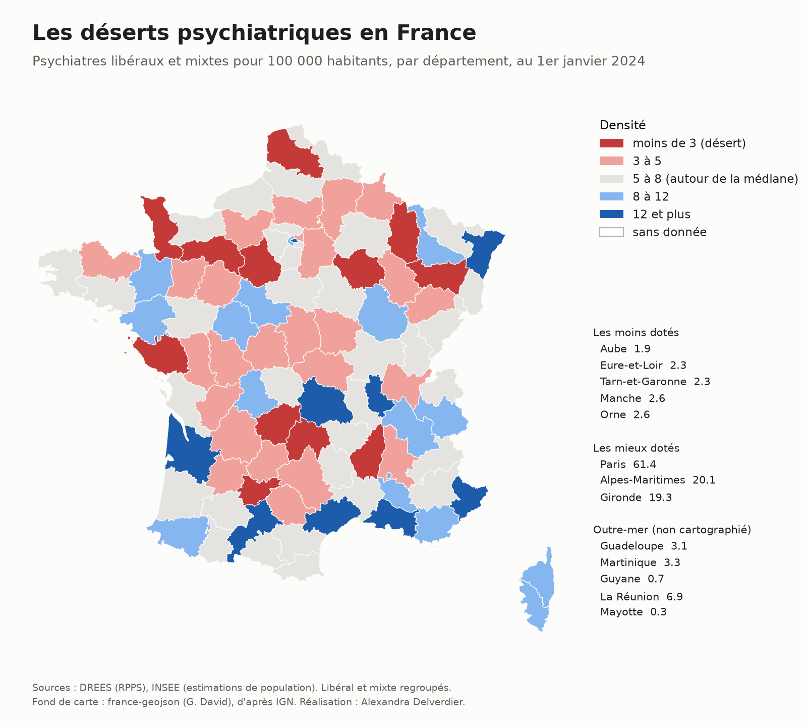

# Santé mentale en France : offre de soins et consommation de psychotropes

Projet personnel d'analytics engineering sur une stack AWS (S3, Athena, dbt).

Infirmière pendant 8 ans, dont plusieurs années en psychiatrie et neurologie au Centre Hospitalier de Montauban, j'ai voulu objectiver une question que j'ai rencontrée sur le terrain : **les territoires qui manquent de psychiatres et de psychologues consomment-ils davantage de psychotropes ?** L'idée sous-jacente : faute d'accès à un spécialiste, le médecin généraliste compenserait par le médicament.



## Principaux résultats

**1. Près de 6,9 millions de personnes** ont eu au moins un antidépresseur remboursé en 2025, soit environ 1 personne sur 10. La hausse est générale (+3 à +5 % en un an dans toutes les régions).

**2. De forts écarts régionaux, qui ne s'expliquent pas par l'âge.** À structure d'âge et de sexe identique, la Normandie compte 119 consommants d'antidépresseurs pour 1 000 habitants en 2025, contre 87 en Île-de-France (+37 %).

**3. Pas de lien démontré entre offre et consommation à l'échelle régionale.** La corrélation entre densité de psychiatres et consommation d'antidépresseurs vaut -0,37 sur les 12 régions de métropole, mais elle est entièrement portée par l'Île-de-France : sans elle, elle tombe à 0,08, et la corrélation de rangs (Spearman) vaut 0,03. L'analyse dans le temps (2014-2024) aboutit au même constat : en suivant l'évolution de chaque région, aucun lien n'apparaît entre la progression de l'offre et celle de la consommation une fois l'Île-de-France retirée (corrélation de 0,07 pour les psychiatres, de -0,11 pour les psychologues). L'Île-de-France est la seule région qui crée une relation apparente, dans les deux approches. L'hypothèse de départ n'est pas confirmée à cette maille.

**4. Une offre libérale très inégale, structurée par les CHU.** En 2024, Paris compte 61,4 psychiatres libéraux pour 100 000 habitants, l'Aube 1,9. Les départements les mieux dotés sont ceux des grandes métropoles universitaires ; les moins dotés sont souvent ruraux ou périurbains et voisins de ces métropoles (Eure-et-Loir, Tarn-et-Garonne, Ardèche). Ces déserts se cumulent : le quart des départements les moins dotés en psychiatres libéraux compte aussi 2 fois moins de psychiatres hospitaliers, 20 % de lits de psychiatrie et 24 % de psychologues en moins que le quart le mieux doté. Seules les places d'hôpital de jour sont réparties de façon homogène.

**5. Une convergence trop lente.** Entre 2014 et 2026, les psychiatres libéraux progressent davantage dans les départements les moins dotés (+23 %) que dans les mieux dotés (+2 %), mais sur des effectifs si faibles que le nombre de départements sous 3 psychiatres libéraux pour 100 000 habitants reste stable (entre 13 et 17).

**6. Deux trajectoires d'offre opposées.** Entre 2012 et 2024, le nombre de psychologues a doublé (de 38 000 à 77 000), tandis que celui des psychiatres n'a progressé que de 10 %. À l'hôpital, la psychiatrie a perdu 19 % de ses lits entre 2000 et 2024 (de 62 800 à 50 600), et les places d'hôpital de jour créées (+3 800) ne compensent pas les fermetures : la capacité totale recule de 7 % depuis 2014.

**7. Deux tendances de consommation opposées.** Entre 2014 et 2024, la consommation standardisée d'antidépresseurs augmente dans toutes les régions de métropole, tandis que celle d'anxiolytiques recule partout, de 9 à 30 consommants pour 1 000 habitants selon les régions.

## Architecture

```
Open Medic (Assurance Maladie)   INSEE (population)   DREES (RPPS, ADELI, SAE)
              │                         │                    │
              └──── scripts d'ingestion (bash, Python) depuis AWS CloudShell ────┘
                                        │
                     S3 : couche raw (CSV UTF-8, partitionnés par année)
                                        │
                       Athena : tables externes (catalogue Glue)
                                        │
                  dbt-athena : staging → intermediate → marts (Parquet)
```

- **Stockage** : un bucket S3 en région Paris (eu-west-3), données brutes conservées telles que publiées, converties en UTF-8.
- **Requêtage** : Athena, facturé au volume scanné (l'ensemble du projet coûte quelques centimes).
- **Transformation** : dbt Core avec l'adaptateur Athena, exécuté en local. Vues pour le staging et l'intermediate, tables Parquet pour les marts.
- **Sécurité** : compte root protégé par MFA et inutilisé, utilisateur d'administration distinct, utilisateur technique `dbt-runner` limité à Athena et à ce seul bucket (principe du moindre privilège), alerte budgétaire.

## Sources

| Source | Contenu | Grain | Période |
|---|---|---|---|
| [Open Medic](https://www.data.gouv.fr/datasets/open-medic-base-complete-sur-les-depenses-de-medicaments-interregimes) (Assurance Maladie) | Médicaments remboursés en ville, nombre de consommants | Molécule ou classe x âge x sexe x région | 2014-2025 |
| [Estimations de population](https://www.insee.fr/fr/statistiques/8721456) (INSEE) | Population au 1er janvier | Région ou département x sexe x âge | 1975-2026 |
| [Démographie des professionnels de santé](https://www.data.gouv.fr/datasets/la-demographie-des-professionnels-de-sante-depuis-2012) (DREES) | Psychiatres (RPPS), psychologues (ADELI) | Département x mode d'exercice | 2012-2026 (psychologues : 2012-2024) |
| [Statistique annuelle des établissements de santé](https://data.drees.solidarites-sante.gouv.fr/explore/dataset/708_bases-statistiques-sae/information/) (DREES, série CAPACT) | Lits et places de psychiatrie | Établissement x année | 2000-2024 |

## Modélisation dbt

```
staging          stg_open_medic__consommants        consommants par molécule (ATC5)
                 stg_open_medic__consommants_atc3   consommants par classe (ATC3)
                 stg_open_medic__base               boîtes et montants par présentation
                 stg_insee__population              population régionale
                 stg_insee__population_departement  population départementale
                 stg_drees__psychiatres             psychiatres par département
                 stg_drees__psychologues            psychologues par département
                 stg_sae__capacites_psychiatrie     lits et places par établissement

intermediate     int_atc__referentiel               libellés ATC de référence
                 int_open_medic__consommants_psy    consommants de psychotropes par molécule
                 int_insee__population_open_medic   population au périmètre Open Medic
                 int_offre_sante_mentale__region_annee

marts            mart_psychotropes__region_annee         consommants par région et classe
                 mart_psychotropes__taux_region_annee    taux bruts et standardisés
                 mart_sante_mentale__region_annee        offre x consommation (mart central)
                 mart_offre__departement_annee           offre par département
```

Les référentiels (régions, tranches d'âge, prescripteurs, classes de psychotropes, correspondances INSEE) sont versionnés en seeds. Le projet compte une cinquantaine de tests (unicité, non-nullité, intégrité référentielle, valeurs acceptées).

## Choix de méthode

- **Psychotropes retenus** : classes ATC N05A (antipsychotiques), N05B (anxiolytiques), N05C (hypnotiques), N06A (antidépresseurs), N06B (psychostimulants).
- **Compter des personnes, pas des molécules** : une personne qui prend deux antidépresseurs différents est comptée deux fois au niveau de la molécule. Les taux par classe s'appuient donc sur les fichiers de consommants au niveau ATC3, sans double compte.
- **Taux standardisés** sur l'âge et le sexe (méthode directe, population de référence : France entière 2025), pour comparer les régions à structure démographique égale. Les taux bruts sont conservés.
- **Dénominateurs** : population moyenne de l'année pour la consommation (un flux), population au 1er janvier pour les effectifs de professionnels (un stock).
- **Périmètre géographique aligné** : Open Medic regroupe les DROM d'une part, PACA et la Corse d'autre part. Les populations et les effectifs de professionnels sont agrégés de la même façon via une table de correspondance.

## Qualité des données : ce que les tests ont révélé

- **Rupture de schéma en 2016** : les fichiers 2014-2015 n'ont pas de libellés. Ils sont rangés dans des tables séparées et unis dans le staging ; les libellés manquants sont reconstitués à partir des années suivantes, plus un petit seed de compléments pour quatre codes disparus (flunitrazépam, méprobamate, un code ATC4 recodé ensuite).
- **Format numérique français** (virgule décimale, point des milliers) : converti par une macro dédiée.
- **Secret statistique** : les effectifs de moins de 11 personnes sont masqués et regroupés dans une région « inconnue ». Leur part est mesurée (0,3 % des consommants d'antidépresseurs en 2025).
- **Anomalie 2025** : l'Assurance Maladie a corrigé en juillet 2026 la région des bénéficiaires 2025. La catégorie « inconnue » est divisée par deux entre 2024 et 2025, ce qui gonfle très légèrement la hausse régionale 2025 (0,3 point au plus).
- **Mayotte** : absente des estimations INSEE et du répertoire ADELI avant 2014. Ces valeurs restent nulles (inconnues, et non égales à zéro) et sont déclarées comme exceptions dans les tests.

## Limites

- **Maille régionale** : Open Medic ne descend pas sous la région, ce qui empêche de tester l'hypothèse offre / consommation au niveau des départements, où les écarts d'offre sont les plus marqués.
- **12 régions** : trop peu d'observations pour une analyse statistique robuste. Les corrélations sont présentées comme des pistes, pas comme des preuves.
- **La consommation n'est qu'un indicateur indirect du besoin** : elle reflète aussi les habitudes de prescription, l'accès aux soins et la précarité.
- **Standardisation grossière** : Open Medic ne fournit que trois tranches d'âge (0-19, 20-59, 60 ans et plus).
- **Mayotte** : sa couverture par Open Medic n'est pas confirmée. Elle est exclue des dénominateurs régionaux par défaut, hypothèse paramétrable dans le seed `ref_regions_insee` (colonne `inclus_denominateur`). L'inclure fait baisser le taux des DROM d'environ 15 %.
- **Pédopsychiatrie** : incluse dans la psychiatrie, sans distinction possible dans les données DREES (démographie comme capacités hospitalières).
- **Lits localisés au lieu de l'établissement** : un établissement peut accueillir des patients des départements voisins, ce qui surestime la densité de lits de son département et sous-estime celle de ses voisins.
- **Populations récentes** : provisoires (2024) ou précoces (2025-2026), elles seront révisées par l'INSEE.

## Reproduire le projet

1. Créer un bucket S3 et lancer les scripts du dossier `ingestion/` depuis AWS CloudShell.
2. Déclarer les tables externes dans Athena (base `sante_mentale_raw`).
3. Configurer un profil dbt de type `athena` (voir la [documentation dbt-athena](https://docs.getdbt.com/docs/core/connect-data-platform/athena-setup)), puis :

```bash
python3 -m venv .venv && source .venv/bin/activate
pip install -r requirements.txt
dbt deps
dbt seed
dbt build
```

## Pistes

- Intégration des temps d'accès aux soins (distance au premier psychiatre ou au premier établissement).
- Orchestration de l'ingestion (EventBridge et Lambda, ou Step Functions).
- Visualisation cartographique des déserts psychiatriques par département.

---

Alexandra Delverdier, [LinkedIn](https://linkedin.com/in/alexandra-delverdier-65972b353)
